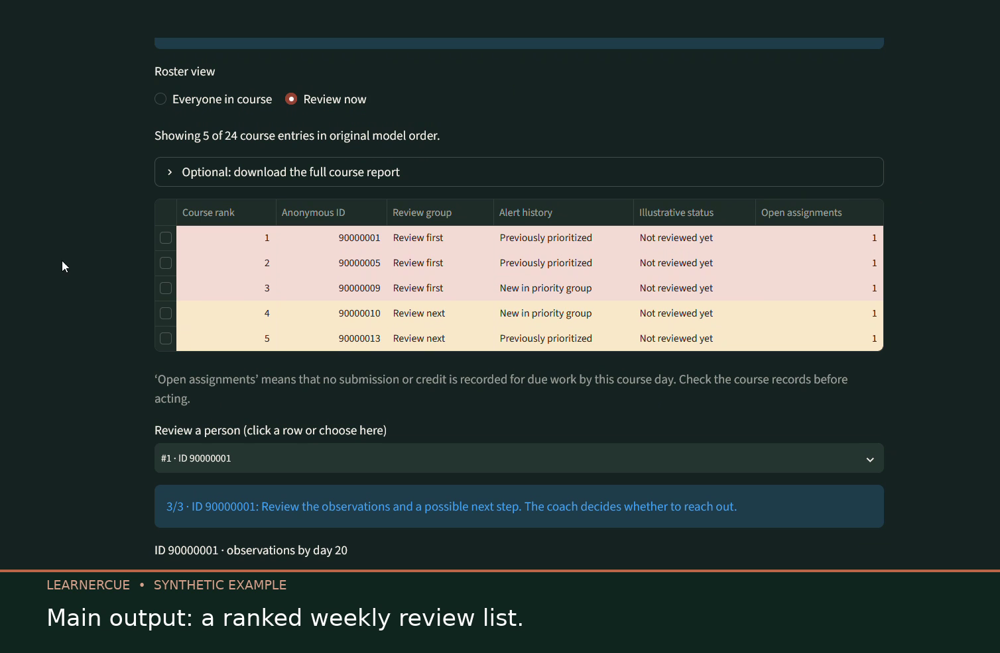

# Tony Willert

**Educational research and data analytics**

I combine a background in education with Python, statistics, and machine learning. My projects turn data into findings that people can understand and tools they can explore.

## Selected projects

### LearnerCue: Who should coaches review first?

**Completed portfolio project · Interactive prototype · English and German**

When coaching time is limited, the order of review matters. LearnerCue uses historical course data to explore which still-enrolled learners could be reviewed first on a given course day. Coaches remain responsible for deciding whether and how to offer support.

**[Try the guided demo](https://fwsproject-cjpggxprduvuak9kugbusk.streamlit.app/)** · **[Watch the 40-second walkthrough](https://tonywillert.github.io/Portfolio/assets/learnercue-demo.mp4)** · **[Explore the code and methods](https://github.com/TonyWillert/FWS_Project)**

*A frame from the actual app walkthrough. The recording uses synthetic example records, has English captions, and is silent. Select the image to watch the video.*

#### From weekly data to a coach's next step

1. **Start the guided example.** The public app opens fabricated weekly records; a prepared weekly CSV can also be uploaded.
2. **Choose a course day and course.** The overview leads into that course's weekly review list.
3. **Review the list and an individual entry.** Coaches can inspect the ranked course roster, recorded activity, and outstanding assignments. The optional “Review now” view narrows the working list; everyone in the course remains available.
4. **Consider a next step.** The prototype shows possible support actions and a simulated review status. The coach decides whether to reach out; the app sends no messages.

**Main output:** A ranked weekly review list with observations to check before offering support. The full course roster can also be downloaded as a printable HTML report. The separate management view explores workload assumptions.

#### My work and an exploratory result

- **Data and question:** Open University Learning Analytics Dataset (OULAD). The analysis covers 16 weekly checkpoints and uses only information available by each checkpoint.
- **Analysis and modelling:** Data quality checks, exploratory analysis, comparisons with simple references and several models, temporal evaluation, and exported weekly Histogram Gradient Boosting models.
- **Application:** A Streamlit app with a course overview, the full ranked course roster, observations for selected learners, and a simulated coach review workflow. The interface is available in English and German.
- **Exploratory result:** On day 27 of the 2014J course presentations, Average Precision was **0.625**, compared with **0.429** for a reference based on course and registration data. The top roughly 20% per course included **1,006 of 2,947** later withdrawals or failures: **34.1% recall** and **64.2% precision**.

The public demo uses **synthetic data to show the interface**. The figures above come from a separate historical OULAD evaluation. The 2014J data were revisited during development, so these are exploratory results rather than an untouched final test. They do not establish that coach outreach prevents withdrawal or that the model transfers to another institution. The management view is labelled as a provisional planning scenario.

### What this project demonstrates

| Skill | Evidence in LearnerCue |
| --- | --- |
| Educational research | Defined a time-specific question and outcome, checked what OULAD can and cannot support |
| Data analysis | Joined and inspected course, registration, assessment, and activity data; built weekly snapshots without later outcomes as inputs |
| Machine learning | Compared baselines and models, separated people in development splits, trained 16 weekly pipelines, and reported precision, recall, and Average Precision |
| Evaluation and judgement | Tested on later course presentations, disclosed repeated inspection of 2014J, examined group differences, and limited claims to exploratory findings |
| Product development | Built a bilingual Streamlit app with a coach workflow, input validation, synthetic demo data, and a printable course report |
| Communication | Documented methods, results, limitations, and a runnable public demonstration |

**Stack:** Python · pandas · scikit-learn · Streamlit · Jupyter · Git

## About me

I have a master's degree in educational sciences and experience with empirical work in higher education. I am particularly interested in projects that connect data analysis with education and social questions.

[GitHub profile](https://github.com/TonyWillert) · [LearnerCue repository](https://github.com/TonyWillert/FWS_Project)
